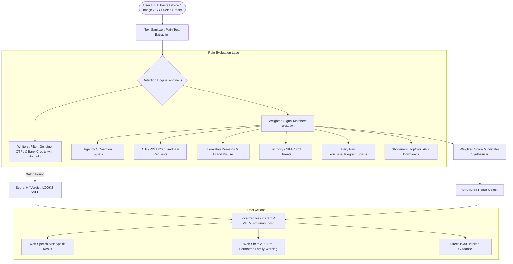

# BaitCheck Architectural & Execution Plan: PLAN.md
*Tagline: "Don't take the bait."*

---

## 1. Project Overview & Guiding Constraints

BaitCheck is a mobile-first Progressive Web Application (PWA) designed to protect citizens, seniors, and first-time smartphone users from smishing, WhatsApp fraud, and deceptive digital communications in seconds.

### Core Non-Negotiables
1. **Zero External Dependencies / Zero CDN**: No external frameworks, no Tailwind CDN, no external fonts. Everything runs locally and works 100% offline.
2. **On-Device Sovereign Analysis**: User text never leaves the phone. No remote API calls with message content.
3. **Multi-Script Accessibility**: Native support for English, Hindi (हिन्दी), and Assamese (অসমীয়া, including script-specific characters ৰ and ৱ).
4. **Strict Security Model**: Strict Content-Security-Policy (CSP), zero innerHTML injection, suspicious links rendered strictly as plain text (never clickable, never fetched).
5. **Ultra-Simple Elderly UX**: Body text $\ge 18\text{px}$, tap targets $\ge 48\text{px}$, single primary action per view, voice read-aloud support.

---

## 2. File Structure

```text
c:\Users\mkgsa\promptwar\
├── index.html               # Semantic HTML single-page PWA container
├── styles.css               # Vanilla CSS implementing design-system/MASTER.md
├── app.js                   # Application coordinator, DOM bindings, Speech, PWA
├── engine.js                # Core explainable rule-based scoring engine
├── rules.json               # Modular weighted detection rules and trusted whitelists
├── manifest.json            # PWA Web App Manifest (offline-installable)
├── sw.js                    # Service Worker caching all assets for offline execution
├── i18n/                    # Localized interface strings & action templates
│   ├── en.json              # English strings
│   ├── hi.json              # Hindi (हिन्दी) strings
│   └── as.json              # Assamese (অসমীয়া) strings
├── design-system/
│   └── MASTER.md            # Accessibility-first design system specification
├── test-messages.json       # 25 ground-truth test messages (EN, HI, Hinglish, AS)
├── tests.html               # In-browser test runner interface (>= 90% target)
├── test-runner.js           # Automated test evaluation script
├── PLAN.md                  # This master architecture specification
└── README.md                # Run instructions, architecture notes, demo script
```

---

## 3. Data Flow Architecture



---

## 4. Rule Schema (`rules.json`)

```json
{
  "version": "1.0",
  "thresholds": {
    "safeMax": 24,
    "cautionMax": 59,
    "dangerMin": 60
  },
  "whitelist": [
    {
      "id": "WL_GENUINE_OTP",
      "regex": "\\b(OTP|One Time Password)\\b.*\\b(do not share|valid for|INR|Rs\\.)\\b",
      "mustNotHaveLinks": true
    },
    {
      "id": "WL_BANK_TRANSACTION",
      "regex": "\\b(debited|credited)\\b.*\\b(A/c|card|ending|available bal)\\b",
      "mustNotHaveLinks": true
    }
  ],
  "signals": [
    {
      "id": "SIG_APK_DOWNLOAD",
      "category": "malware",
      "weight": 55,
      "regex": "\\.apk(\\?|\\b|$)",
      "reason_key": "reason_apk_download"
    },
    {
      "id": "SIG_URGENCY",
      "category": "urgency",
      "weight": 25,
      "patterns": ["immediately", "within \\d+ hours?", "blocked today", "suspended today", "SIM.*block"],
      "patterns_hi": ["तुरंत", "आज ही", "24 घंटे", "बंद हो जाएगा", "ब्लॉक"],
      "patterns_as": ["তৎক্ষণাৎ", "আজিৰ ভিতৰত", "বন্ধ কৰা হ'ব", "ব্লক"],
      "reason_key": "reason_urgency"
    }
  ]
}
```

---

## 5. Security & Privacy Review

1. **Zero Data Egress**: All analysis is performed synchronously in `engine.js` using local JavaScript regular expressions. No `fetch` or `XMLHttpRequest` is ever issued with user input.
2. **Strict Content-Security-Policy (CSP)**:
   ```html
   <meta http-equiv="Content-Security-Policy" content="default-src 'self'; script-src 'self'; style-src 'self' 'unsafe-inline'; img-src 'self' data:; connect-src 'self'; font-src 'self';">
   ```
3. **HTML Injection Immunity**:
   - Highlighting words and links uses DOM node construction (`document.createElement('span')`, `document.createTextNode()`) or strict entity escaping.
   - Text is never assigned directly via `element.innerHTML = userInput`.
4. **Defanged Links**: Suspicious links are displayed inside `<span class="defanged-link">` with copy options, NEVER inside `<a href="...">`.

---

## 6. Execution Milestones

- **Phase 1: TDD & Test Suite**: Construct `test-messages.json` with 25 realistic multilingual cases and build `tests.html`.
- **Phase 2: Detection Engine**: Write `rules.json` and `engine.js` until test suite achieves $\ge 90\%$ pass rate with $0\%$ false alarms.
- **Phase 3: Multi-Language Dictionaries**: Create `i18n/en.json`, `i18n/hi.json`, and `i18n/as.json`.
- **Phase 4: Accessible UI & PWA**: Build `index.html`, `styles.css`, `app.js`, `manifest.json`, and `sw.js`.
- **Phase 5: Verification & Delivery**: Run audits for contrast, touch targets, offline caching, and responsive design at 360px.
