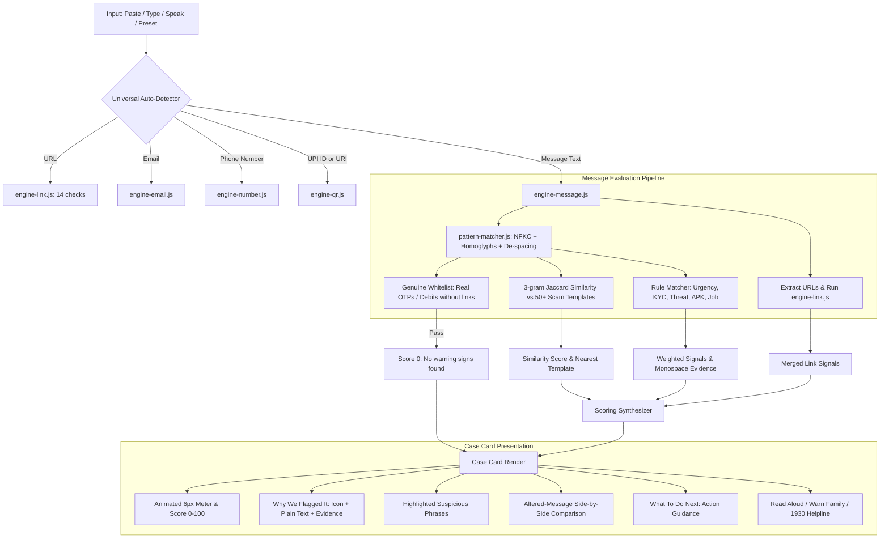

# BaitCheck Architecture & Implementation Plan: PLAN.md
*Project: BaitCheck ("Don't take the bait.")*  
*Hackathon Problem Statement: PS01 — Suspicious Message & Communication Fraud Detector*

---

## 1. Guiding Principles & Non-Negotiables

1. **Zero External Dependencies / Zero CDN**: Pure vanilla HTML5, CSS3, and ES modules. No Tailwind CDN, no npm run build, no external scripts. 100% offline-first.
2. **On-Device Sovereign Privacy**: No message, link, email, or input ever leaves the device. Clear pledge on-screen: *"Your messages never leave your phone."*
3. **No Accounts, No Server**: Zero user profiles, zero logins, zero cookies, zero telemetry.
4. **Altered-Message & Known-Pattern Matching**: Scammers modify words, inject spaces, and use homoglyphs/leetspeak. BaitCheck normalizes text and matches against 50+ generic scam templates using 3-gram Jaccard and shingle similarity.
5. **Calm Paper-and-Ink Visuals**: Parchment canvas (`#F6F3EA`), deep indigo accent (`#2B3A8C`), hairline borders (`#E3DED1`), high contrast ($>7:1$), compact typography. No glassmorphism, no neon, no dark-pattern urgency.
6. **Multi-Script Accessibility**: Native support for English, Hindi (हिन्दी), and Assamese (অসমীয়া, with correct handling of ৰ and ৱ). Dynamic text scaling ($A-$ / $A$ / $A+$).
7. **Strict Security Model**: Strict Content-Security-Policy (CSP), all user input safely rendered via `textContent` or escaped before word-highlighting. Suspicious links rendered strictly as plain text (never clickable, never prefetched).

---

## 2. Directory & Module Architecture

```text
c:\Users\mkgsa\promptwar\
├── index.html                  # Single-page shell with hash routing container
├── styles.css                  # Paper-and-ink design system, 4px grid, line-and-hook motion
├── sw.js                       # Service worker caching all assets for offline execution
├── manifest.json               # Web App Manifest (standalone mobile PWA)
│
├── data/                       # Bundled static knowledge bases
│   ├── rules.json              # Scoring weights, threshold bands, regex patterns
│   ├── known-scams.json        # 50+ generic composite scam templates (EN, HI, Hinglish, AS)
│   ├── brands.json             # Legitimate Indian brands, banks, and official domains
│   ├── tlds.json               # Suspicious and high-risk TLD definitions
│   ├── shorteners.json         # Known URL shortener domains
│   ├── disposable-domains.json # Disposable email provider domains
│   ├── scams.json              # 14 detailed library entries for #/known-scams
│   └── guides.json             # 6 practical digital safety guides for #/guides
│
├── js/                         # Modular client-side engines (ES modules)
│   ├── router.js               # Hash router (#/, #/check/*, #/known-scams, #/guides, etc.)
│   ├── pattern-matcher.js      # NFKC normalization, homoglyphs, leetspeak, 3-gram Jaccard
│   ├── engine-message.js       # Hero PS01 message engine (urgency, KYC, extortion, jobs)
│   ├── engine-link.js          # 14 link checks (punycode, shorteners, brand lookalikes)
│   ├── engine-email.js         # Free-mail masquerade, spoofed brand, header parser
│   ├── engine-number.js        # Indian phone (+91, 140 telemarketing, 1800, international)
│   ├── engine-qr.js            # UPI URI parser (pa, pn, am, collect warning)
│   ├── engine-website.js       # 10-point interactive trust checklist + link analysis
│   └── app.js                  # App coordinator, UI rendering, speech, sharing, history
│
├── i18n/                       # Localized string bundles
│   ├── en.json                 # English strings
│   ├── hi.json                 # Hindi (हिन्दी) strings
│   └── as.json                 # Assamese (অসমীয়া) strings
│
├── design-system/
│   └── MASTER.md               # Design tokens, accessibility rubric, line-and-hook motion
│
├── test-inputs.json            # 60+ ground-truth test cases (including 30 altered variations)
├── tests.html                  # In-browser visual test suite runner
├── run-tests.node.js           # CLI Node.js runner for CI/eval validation
├── PLAN.md                     # This architectural document
└── README.md                   # Setup guide, algorithm details, 2-minute demo script
```

---

## 3. Data Flow & Evaluation Pipeline



---

## 4. Normalization & Altered-Message Matching Pipeline

1. **NFKC Canonical Decomposition & Composition**: Harmonizes full-width and compatibility characters.
2. **Zero-Width Character Removal**: Strips invisible spaces (`\u200B`, `\u200C`, `\u200D`, `\uFEFF`).
3. **Homoglyph & Leetspeak Mapping**:
   - Cyrillic lookalikes: `а` $\to$ `a`, `е` $\to$ `e`, `о` $\to$ `o`, `р` $\to$ `p`, `с` $\to$ `c`, `у` $\to$ `y`, `х` $\to$ `x`, `Т` $\to$ `T`.
   - Leetspeak substitutions: `0` $\to$ `o`, `1` $\to$ `l`, `$` $\to$ `s`, `@` $\to$ `a`, `3` $\to$ `e`, `5` $\to$ `s`, `7` $\to$ `t`.
4. **Spaced-Out Letter De-obfuscation**: Regex collapses spaced words like `"O T P"` $\to$ `"otp"`, `"K Y C"` $\to$ `"kyc"`.
5. **Entity Masking**: Replaces amounts (`Rs. 5000` $\to$ `<AMT>`), phone numbers (`+91 98765 43210` $\to$ `<PHONE>`), URLs $\to$ `<URL>`, dates $\to$ `<DATE>`.
6. **Obfuscation Detection**: Flags deliberate evasion if homoglyphs, zero-width characters, or spaced letters are discovered: *"This message looks deliberately altered to slip past filters"*.
7. **Similarity Metric**:
   $$\text{Similarity} = 0.6 \times \text{Jaccard}_{3\text{-gram}} + 0.4 \times \text{TokenContainment}$$
   - $\ge 0.75$: **Matches a known scam pattern**
   - $0.50 - 0.74$: **Resembles a known scam pattern**

---

## 5. Scoring & Verdict Bands

Scoring is transparent, deterministic, and bounded between 0 and 100:

| Score Band | Verdict Heading | Badge Color | Semantic Meaning |
|:---|:---|:---|:---|
| **0 – 24** | **No warning signs found** | `#1F7A4D` (Green) | No known scam indicators detected in standard checks. |
| **25 – 54** | **Be careful** | `#9A5B00` (Amber) | Contains caution signs (e.g., shortener, generic greeting). |
| **55 – 100** | **Likely scam — don't bite** | `#B42318` (Red) | High-confidence fraud indicators or known scam pattern match. |

*Note: BaitCheck never uses the word "safe" or "verified" — an absence of flags does not constitute a legal guarantee.*

---

## 6. Security & Privacy Audit Requirements

- **CSP Meta Tag**: `default-src 'self'; script-src 'self' 'unsafe-inline'; style-src 'self' 'unsafe-inline'; img-src 'self' data:; connect-src 'self'; font-src 'self';`
- **Zero Remote Exfiltration**: `fetch()` or `XMLHttpRequest()` are strictly forbidden from transmitting user message text.
- **XSS Prevention**: User text is rendered strictly using `document.createTextNode` or `element.textContent`. When highlighting keywords, snippets are HTML-escaped before wrapping in `<mark class="flagged-word">`.
- **Link Neutralization**: All detected URLs are rendered as plain `<code>` text with `user-select: all`. They are never wrapped in `<a href="...">` and never fetched.

---

## 7. Deliverables & Acceptance Verification

1. `test-inputs.json` with 60+ cases (25 messages, 8 links, 4 emails, 3 numbers, 2 UPI, 30 altered-pattern variations, 10 genuine messages).
2. Pass rate $\ge 90\%$ on test suite with **0% false alarms** on genuine samples.
3. Mobile-first layout verified at 360px width with no horizontal overflow.
4. Complete offline functionality verified via Service Worker cache.
5. All 3 languages (English, Hindi, Assamese) tested and verified.
